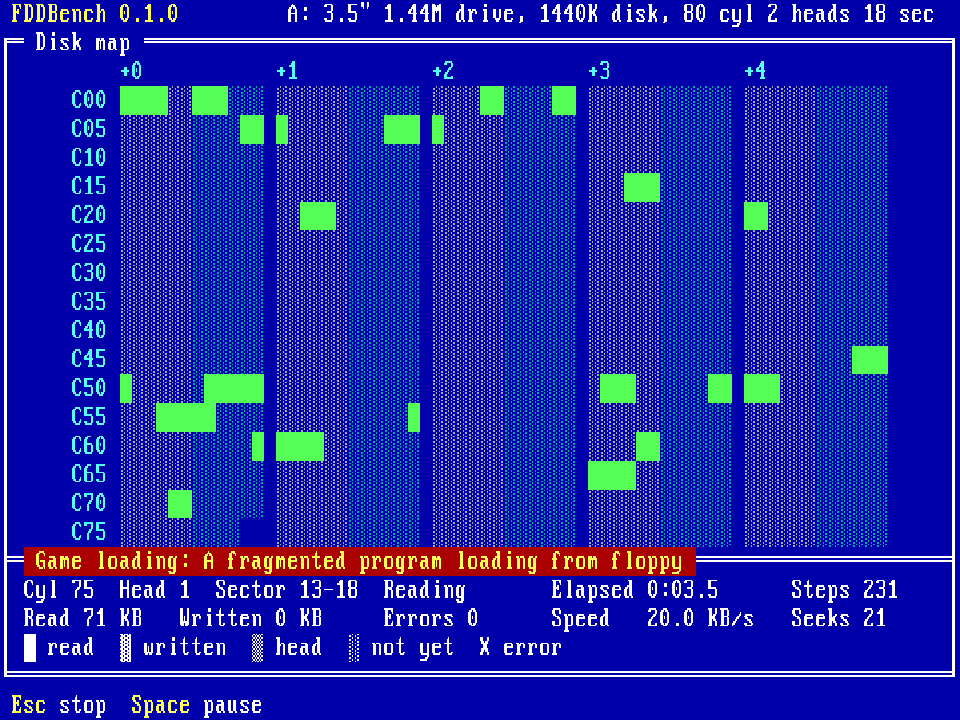

# FDDBench

**Floppy drive sounds and benchmark for DOS.** FDDBench runs a series of operations on a floppy drive, each chosen for how it sounds: spin-up, single steps, seeks short and long, whole-disk reads, a program loading. As it goes, a disk map in the style of Norton's disk tools shows every sector being read.



It was written to show how realistic [FDDSynthPro](https://github.com/MaverickUK/FDDSynthPro), a floppy drive emulator that plays a real drive's sounds, sounds on a real PC. It works with any drive, real or emulated, so the same run can compare the two. The look is [GameMinder](https://github.com/MaverickUK/GameMinder)'s.

## Running it

```
FDDBENCH [A: | B:] [/AUTO] [/DUMP:file]
```

Put any formatted disk in the drive and run `FDDBENCH` (drive A: unless you name B:). Press **1** to **9** for a scenario, **A** to run them all, **Esc** to stop one or to quit, **Space** to pause.

| | Scenario | What to listen for |
|---|---|---|
| 1 | Spin-up and idle | Spin-up, the idle hum, then spin-down when the BIOS stops the motor |
| 2 | Recalibrate | The head running back to cylinder 0 |
| 3 | Single steps | One step at a time: separate clicks |
| 4 | Short seeks | Back and forth near the middle: short buzzes |
| 5 | Full stroke | First cylinder to last and back: the longest seek |
| 6 | Butterfly | Out and in, meeting in the middle |
| 7 | Sequential read | Every track in order, as DISKCOPY reads |
| 8 | Random read | Sectors all over the disk: a busy head |
| 9 | Game loading | A fragmented program loading from floppy |

The scenarios only read, through the BIOS, so the disk's contents don't matter and nothing on it changes. Each one visits the same sectors every time it runs, so it sounds the same every time.

In the map, each cell is three sectors of one track; each group of cells is a cylinder (head 0, then head 1 in cyan), and each row starts with its first cylinder's number. Green is read, a flashing cell is where the head is now, and a red X is a sector the BIOS couldn't read.

Every run is logged to `FDDBENCH.LOG` beside the program, with the time of day, to line up with the drive's own log. The log is written between scenarios, never during one, so it doesn't add seeks of its own.

`/AUTO` runs every scenario and exits; `/DUMP:file` then saves the final screen's text (the smoke test uses both).

It runs on any PC from an 8088 up, in text mode, on CGA, EGA, VGA or MDA.

## Status

Version 0.1.0 has the read scenarios and the map. Next, from the [design](DESIGN.md): the benchmark (RPM, track-to-track and full-stroke seek times, access time, throughput), then write scenarios behind a warning, then themes and help.

## Building

See [BUILD.md](BUILD.md).

## Licence

GPL-3.0, as GameMinder, whose code it borrows.
